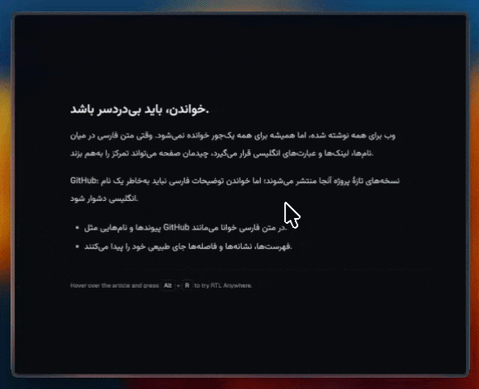

# RTL Anywhere

[](https://github.com/sadeqi-ah/rtl-anywhere/actions/workflows/check.yml)

Right-align Persian, Arabic, Hebrew, and mixed-direction text on any website without flipping the whole page.

## Install

1. Install [Tampermonkey](https://www.tampermonkey.net/) or [Violentmonkey](https://violentmonkey.github.io/).
2. **[Install RTL Anywhere](https://raw.githubusercontent.com/sadeqi-ah/rtl-anywhere/main/rtl-anywhere.user.js)** and confirm the installation prompt.
3. Hover a paragraph and press `Alt+R` (`⌥R` on macOS). Press it again to revert.

Your userscript manager handles updates.



## Usage

| Shortcut (default)    | Action                                                       |
| --------------------- | ------------------------------------------------------------ |
| `Alt+R` / `⌥R`        | Toggle RTL on selected text or the element under your cursor |
| `Alt+Shift+R` / `⌥⇧R` | Pick mode: highlight and click an element; `Esc` to exit     |
| `Alt+Shift+Z` / `⌥⇧Z` | Undo changes on the current page                             |

In pick mode, `Shift`+click remembers an element for future visits to that site. Use `↑` / `↓` or `⌥`+wheel to adjust the highlighted element before clicking. If the wrong element toggles, try pick mode. Shortcuts can be changed under **Settings → Shortcuts** in your userscript manager's menu.

## Auto-detect

Off by default. Enable it globally or for the current site under **Settings → Auto**. It applies RTL when at least 60% of an element's letters are RTL, or its first letter is RTL. It skips already-RTL content, editors, and code/math regions, and handles content added later.

## Fonts

**Settings → Font** sets the font used for RTL text. It lists open-source Persian fonts (Vazirmatn, Estedad, Shabnam, Nahid, Sahel, Samim) and commercial ones (IRANSansX, Yekan Bakh, Dana and others).

- **Open-source fonts** use your installed copy if you have one. Otherwise they download from jsDelivr the first time you pick one, at a pinned version and checked against a SHA-256 hash.
- **Commercial fonts** are never downloaded. They work only if installed on your device. If the script can't detect one (some browsers hide installed fonts), you can still pick it.
- **Your own fonts:** in Chromium browsers, **Browse my fonts…** lists every font on your device after you allow access. Only the first 50 matches are drawn, so search to narrow down. In other browsers, type the font's family name into the box instead.

Choose **Default** to keep each page's own font.

## Privacy and permissions

The userscript runs on websites you visit (`@match *://*/*`) so its shortcut is available wherever you need it. Settings are stored locally through your userscript manager: shortcuts, auto-detect preferences, remembered site selectors, the selected font, and onboarding state. Page text, selected text, URLs, and browsing history are not saved. There is no tracking or analytics. The only network request is the optional download of an open-source font (see Fonts), made through `GM_xmlhttpRequest` to `cdn.jsdelivr.net` only after you pick a font that is not installed.

One-off toggles are not saved; reloading restores the original layout unless auto-detect or a remembered site rule is enabled. Manage remembered elements under **Settings → Sites**. The script uses `GM_getValue` / `GM_setValue` for settings, `GM_addStyle` for CSS, and `GM_registerMenuCommand` for menu actions, and `GM_xmlhttpRequest` for the font download.

## Development

Requires Node.js `>=22.18` and pnpm `10.27.0`:

```bash
pnpm install
pnpm run check
```

See [CONTRIBUTING.md](CONTRIBUTING.md) for build, test, and bundle instructions. Review [SECURITY.md](SECURITY.md) before changing permissions or storage.

## License

[MIT](LICENSE)
